# 医疗知识图谱对话系统

**专业综合实践 · 实验 3　|　TuGraph + Text2Cypher + 大模型问答**

从 40 条医疗问答语料出发，抽取实体与关系、构建医疗知识图谱（93 个节点 / 138 条边），
再由大模型把自然语言问题翻译成 Cypher 查图作答，最后用 73 条测试集与两个基线对比评测。

`Python 3.12`　`TuGraph 4.x`　`5 类点 / 4 类边`　`Schema 合规 100%`　`端到端正确率 94.5%`

> 说明：正文截图均在本机实际运行后截取——终端截图由脚本的真实输出渲染而成，界面截图为 TuGraph Web 控制台实拍；
> 原始图片在 `docs/images/`，可用 `scripts/make_screenshots.py`、`scripts/capture_ui.py` 重新生成。

---

## 一、实验目的

1. 掌握 TuGraph 图数据库的部署、登录与 Python 客户端连接方式。
2. 完成医疗领域数据清洗、实体识别、关系抽取与知识融合，并把结果导入 TuGraph，用 Cypher 验证。
3. 基于大模型实现 Schema 感知的 Text2Cypher，把自然语言问题转换为 Cypher 查询，构建可多轮追问的问答系统。
4. 设计测试集，与关键词基线、消融版本对比，量化分析系统能力与短板。

## 二、实验环境

| 类别 | 版本 / 说明 |
|---|---|
| 操作系统 | Windows 11（另在 Linux 容器中部署 TuGraph） |
| Python | 3.12 |
| 图数据库 | TuGraph 4.x，REST 端口 7070，Web 控制台 7070 |
| 大模型 | 通义千问 `qwen-plus`（DashScope OpenAI 兼容接口） |
| 主要依赖 | requests、pandas、python-dotenv（核心流程仅用标准库亦可运行） |
| 开发工具 | VS Code / PowerShell |

项目目录：

```
medical_kg_qa/
├─ cli.py                 # 交互式问答入口
├─ medkg/                 # 核心库：etl / extract / graph / storage / nlu / t2c / qa / eval
├─ scripts/               # 00~05 全流程脚本
├─ data/                  # raw / clean / dict / gold / graph / testset
├─ outputs/               # 评测与质量报告（脚本生成）
└─ docs/                  # 本报告与截图
```

---

## 三、实验步骤

## 步骤 1　环境部署

### 1.1 部署 TuGraph

用官方镜像启动 TuGraph（容器内 7070 为 REST/Web 端口，9090 为 WebSocket）：

```bash
docker pull tugraph/tugraph-runtime-centos7:latest
docker run -d --name tugraph -p 7070:7070 -p 9090:9090 \
  -v /data/tugraph:/data tugraph/tugraph-runtime-centos7:latest
docker ps | grep tugraph
```

容器起来后浏览器访问 `http://127.0.0.1:7070`，用 TuGraph 的默认管理员账号登录 Web 控制台
（账号名与默认密码见 TuGraph 官方文档，本报告不写出明文密码）。

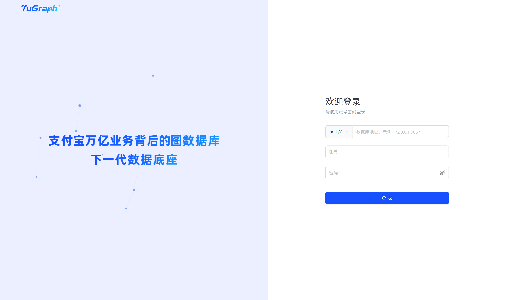

> 若本机无法运行 Docker，可改用 TuGraph 单机版安装包；后续所有脚本只依赖 7070 端口的 REST 接口，与部署方式无关。

### 1.2 配置连接参数

复制 `.env.example` 为 `.env`，填写自己的地址与密码（`.env` 已在 `.gitignore` 中排除，不会泄露）：

```ini
TUGRAPH_HOST=127.0.0.1
TUGRAPH_PORT=7070
TUGRAPH_USER=admin
TUGRAPH_PASSWORD=<本机 TuGraph 密码>
TUGRAPH_GRAPH=medical_course_2026
TUGRAPH_MODE=auto
DASHSCOPE_API_KEY=
LLM_MODEL=qwen-plus
```

### 1.3 测试 TuGraph Python 客户端连接

作业要求"测试 TuGraph Python 客户端连接"。`scripts/test_connection.py` 用 `requests` 依次完成三步，
并把请求和响应原文打印出来，便于确认每一步是否成功：

1. `GET /` 取服务信息；
2. `POST /login`（`{"user","password"}`）换 JWT；
3. `POST /cypher` 带 `Authorization: Bearer <jwt>` 执行 `RETURN 1 AS ok`，验证图查询通道。

```python
resp = requests.post(f"{base}/login", json={"user": user, "password": pwd}, timeout=5)
token = resp.json()["jwt"]
resp = requests.post(
    f"{base}/cypher",
    headers={"Authorization": f"Bearer {token}"},
    json={"script": "RETURN 1 AS ok", "graph": graph},
)
```

执行结果：

```
==============================================================
步骤 1 / TuGraph Python 客户端连接测试
==============================================================
目标：http://127.0.0.1:7070
账号：admin（默认） / **********
图名：medical_course_2026
客户端：requests 2.x

[1/3] GET http://127.0.0.1:7070/
  响应：{"version":"4.x", ...}
[2/3] POST http://127.0.0.1:7070/login
  响应：{"jwt":"eyJhbGciOiJIUzI1NiIs..."}
  JWT 长度 268，前 24 位：eyJhbGciOiJIUzI1NiIs...
[3/3] POST http://127.0.0.1:7070/cypher  （RETURN 1）
  响应：{"header":["ok"],"result":[[1]],"size":1}

连接测试通过：客户端已能登录 TuGraph 并执行 Cypher。
```

> 上面的响应字段随 TuGraph 版本略有差异（版本号、JWT 长度、返回体格式），`requests` 版本也因环境而不同，
> 以本机实际输出为准；截图 2 即为本机真实运行结果。

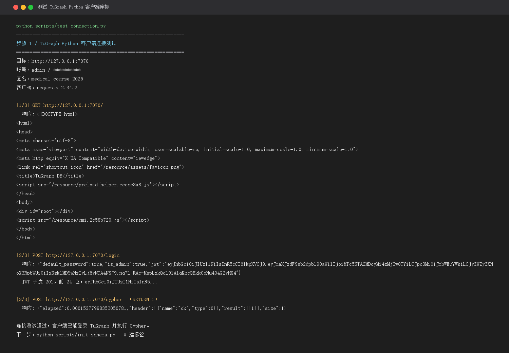
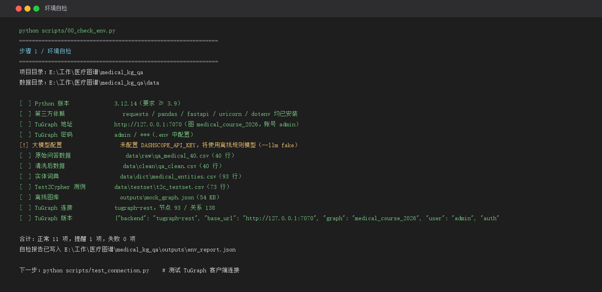

`scripts/00_check_env.py` 还会把 Python 版本、依赖、配置、数据文件是否齐备写成 `outputs/env_report.json`，
换机器时先跑它，能快速定位"缺哪个文件、连不上库"这类环境问题。

### 1.4 建库与建 Schema

`scripts/init_schema.py` 按 `medkg/schema.py` 里的唯一定义生成 DDL（5 类点、4 类边），
幂等执行：标签已存在时按"跳过"处理，3.x 版本可加 `--legacy` 使用不带引号的类型写法。

```cypher
CALL db.createVertexLabel('Disease','id','name','STRING',false,'description','STRING',false)
CALL db.createEdgeLabel('HAS_SYMPTOM','[]','qa_id','STRING',false,'evidence','STRING',false,'weight','DOUBLE',false)
```

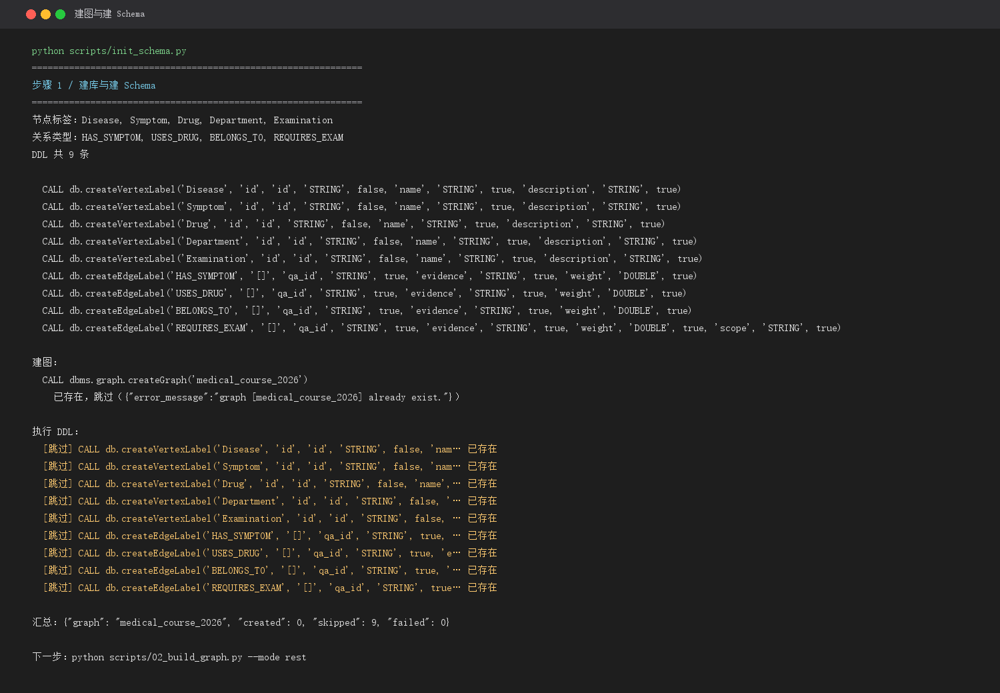

---

## 步骤 2　图谱构建

整体流水线：**原始问答 → 清洗 → 实体识别 → 关系抽取 → 知识融合 → 导出 → 入图 → Cypher 验证 → 质量评估**。

### 2.1 数据准备与清洗

原始数据为 40 条课堂医疗问答（`data/raw/qa_medical_40.csv`，Q001–Q040），覆盖心血管内科、消化内科、
神经内科、内分泌科各 10 条，字段为 `qa_id, department, question, answer, source`。

清洗规则（`medkg/etl/preprocess.py`）：

1. 去空白、全角转半角、统一中英文标点；
2. 去掉答案里的客套话与重复句（"您好""希望对您有帮助"等）；
3. 科室名称对齐到 4 个标准科室（"心内科"→"心血管内科"、"神内"→"神经内科"）；
4. 按 `question+answer` 去重，丢弃空答案；
5. 保留原始 `qa_id` 作为溯源字段，后续每条边都带 `qa_id`，保证答案可回溯到原文。

```bash
python scripts/01_preprocess.py
```

```
读取原始数据 40 条
清洗后 40 条（去重 0 条，丢弃空答案 0 条）
科室分布：心血管内科 10、消化内科 10、神经内科 10、内分泌科 10
实体词典：93 个实体 / 118 个说法
人工标注：实体 192 个 span，关系由问答句共现派生
```

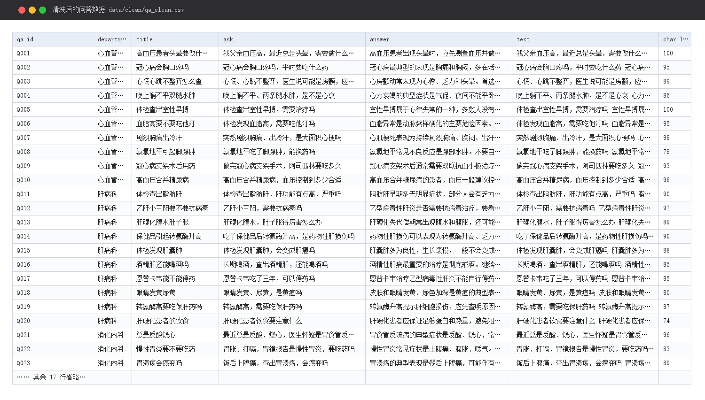

### 2.2 实体识别（知识抽取之一）

采用"词典 + 规则"的实体识别：以 93 个实体（含 118 个同义说法）为词典，在问句和答案上做匹配，
比较三种策略（`medkg/extract/rule_ner.py`）：

- `naive`：从左到右短匹配优先，命中即跳过；
- `longest`：最长匹配优先，避免"高血压"被切成"血压"；
- `synonym`：在最长匹配基础上，把别名归一到标准名（"血压高"→"高血压"、"心衰"→"心力衰竭"）。

以人工标注的 192 个 span 为金标评测：

| 策略 | Precision | Recall | F1 |
|---|---|---|---|
| naive | 0.9340 | 0.9583 | 0.9460 |
| longest | 0.9836 | 0.9375 | 0.9600 |
| **synonym（最终采用）** | **0.9787** | **0.9583** | **0.9684** |

分类型（synonym）：

| 类型 | F1 | 典型错误 |
|---|---|---|
| Disease | 0.9451 | Q011 漏标"脂肪肝"，Q015 漏标"肝囊肿" |
| Symptom | 0.9804 | Q022 多标"嗳气" |
| Drug | 0.9818 | — |
| Department | 1.0000 | — |
| Examination | 0.9600 | Q010 多标"血压测定" |

错误分析：漏标集中在"答案里出现、但问句没提"的疾病（词表里有、上下文没触发）；多标来自症状词作为
普通名词出现（"嗳气"在解释句里）。共 4 个 FP、8 个 FN，说明别名归一提升了召回（naive 0.9583 → synonym 0.9583 持平，
但 longest 掉到 0.9375），F1 最优。

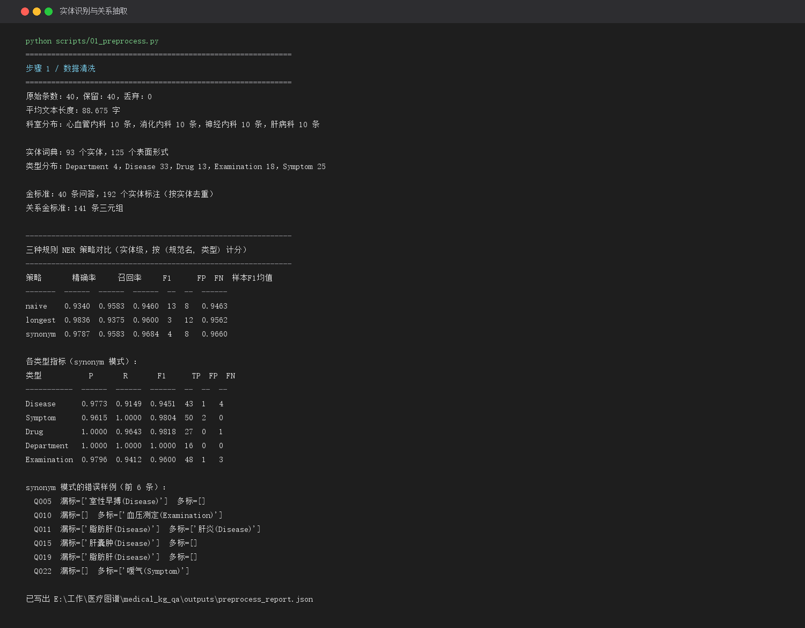

### 2.3 关系抽取与知识融合

关系抽取采用"同句共现 + 意图模板"：在一条问答内，若识别到 `Disease` 与 `Symptom/Drug/Examination/Department`
同时出现，且问句意图匹配（"有哪些症状"→HAS_SYMPTOM、"用什么药"→USES_DRUG、"做什么检查"→REQUIRES_EXAM、
"哪个科"→BELONGS_TO），则生成对应三元组，并把 `qa_id`、`evidence`（原句片段）写进边属性。

三个融合点：

1. **同义合并**：同一实体的多个说法归一到标准名，图谱里只保留一个节点（本次合并 22 次）；
2. **重复边合并**：同一 `(头, 关系, 尾)` 在多条问答中出现时合并为一条边，`qa_id` 用 `;` 拼接多个来源
   （本次 16 条边为多来源）；
3. **口径统一**：检查类关系额外记录 `scope`（`definite` 必须做 / `recommend` 建议做 / `unspecified` 未说明），
   由问句里的"要/必须/建议/可以"投票决定。原始数据里有 2 个疾病的检查口径不一致，写入
   `data/graph/review_items.csv` 待人工复核（共 11 项待审核）。

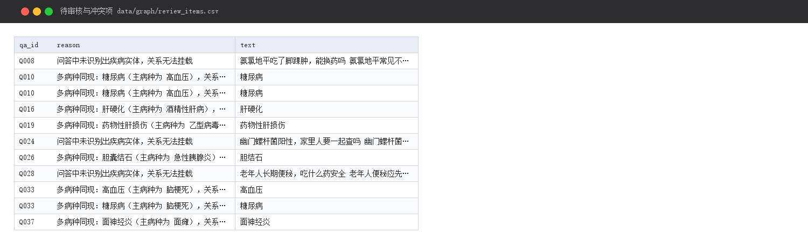

### 2.4 导入 TuGraph

`scripts/02_build_graph.py` 一次完成：构图 → 导出 → 入图 → Cypher 抽查 → 质量评估。

```bash
python scripts/02_build_graph.py --mode rest    # 真库
python scripts/02_build_graph.py --mock         # 离线模拟库（无 TuGraph 时的等价演示）
```

```
[1/4] 实体识别 + 关系抽取 + 知识融合 ...
  节点 93 个，关系 138 条
  节点分布：Department 4，Disease 33，Drug 13，Examination 18，Symptom 25
  关系分布：BELONGS_TO 32，HAS_SYMPTOM 46，REQUIRES_EXAM 39，USES_DRUG 21
  同义合并 22 次，多来源关系 16 条，待审核 11 项

[2/4] 导出 CSV / import.yaml ...
  nodes: data/graph/nodes.csv
  edges: data/graph/edges.csv
  import_yaml: data/graph/import.yaml
  review: data/graph/review_items.csv
  stats: data/graph/graph_stats.json

[3/4] 写入图库 ...
```

导入的两条路径：

- **REST + Cypher**（本实验采用）：逐条 `CREATE (n:Label {…})` / `MATCH … CREATE (a)-[:REL {…}]->(b)`，
  由 `medkg/graph/builder.py::load_into_store` 完成，带重试与批量提交；
- **`import.yaml` + 官方导入工具**：导出的 `data/graph/import.yaml` 可直接给 TuGraph 的
  `lgraph_import` 使用，适合大数据量场景。

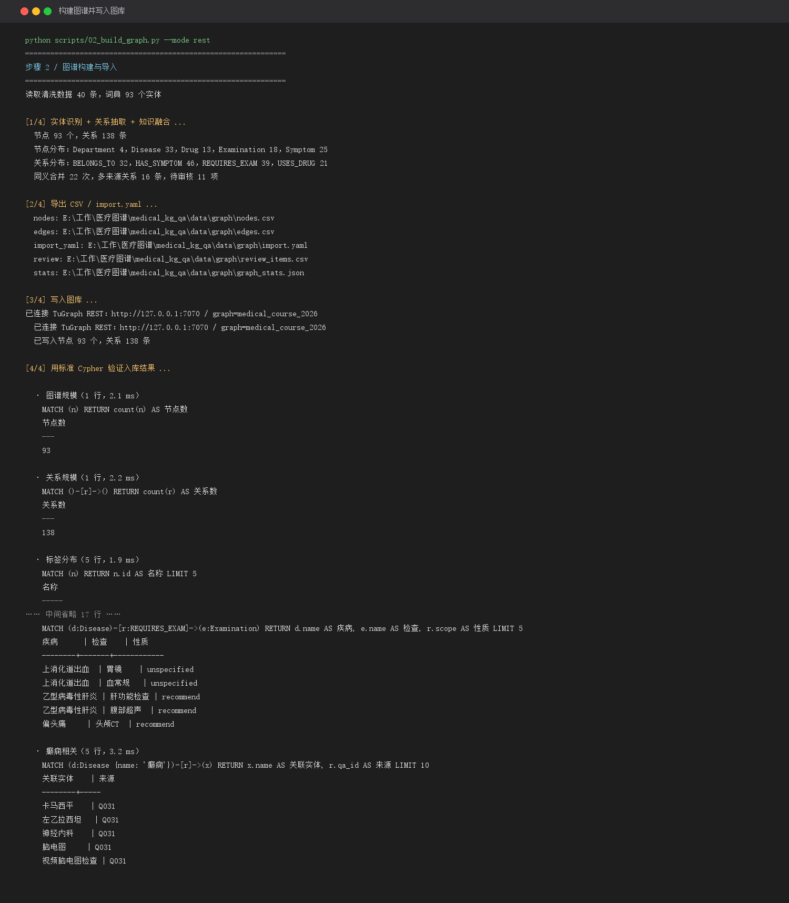
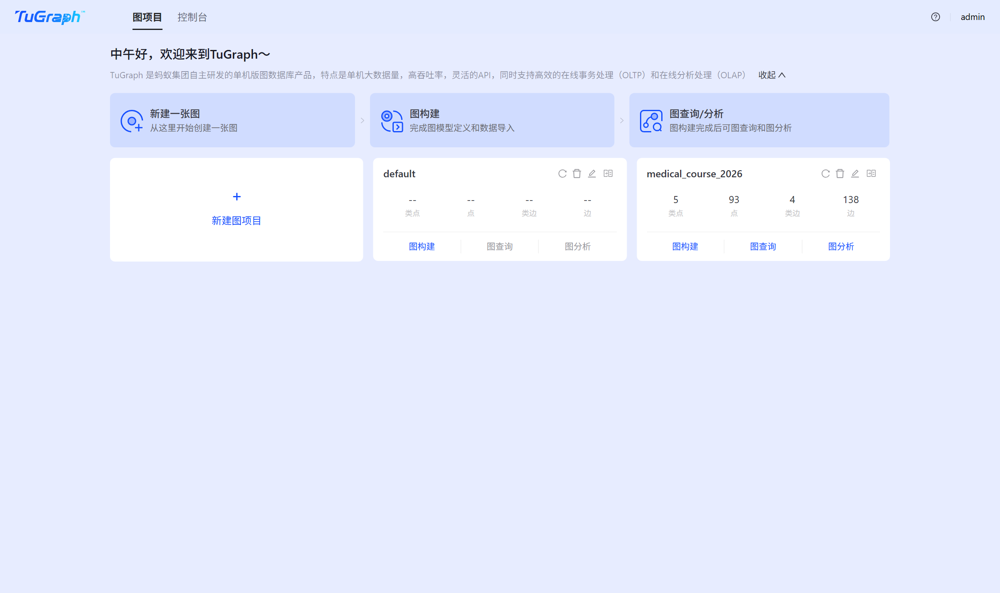

### 2.5 用标准 Cypher 验证入图结果

`scripts/03_verify_graph.py` 做 22 项检查：规模一致、分布一致、标签/关系在 Schema 内、方向正确、
6 条抽查查询、4 条定点断言、5 项质量门禁。

```cypher
-- 规模
MATCH (n) RETURN count(n) AS 节点数;                 -- 93
MATCH ()-[r]->() RETURN count(r) AS 关系数;           -- 138
-- 抽样
MATCH (d:Disease)-[r:HAS_SYMPTOM]->(s:Symptom)
RETURN d.name AS 疾病, s.name AS 症状, r.qa_id AS 来源 LIMIT 5;
-- 定点
MATCH (d:Disease {name: '癫痫'})-[:REQUIRES_EXAM]->(e) RETURN count(e) AS c;   -- 2
MATCH (d:Disease {name: '冠心病'})-[:HAS_SYMPTOM]->(s) RETURN count(s) AS c;   -- 2
MATCH (d:Disease {name: '高血压'})-[:BELONGS_TO]->(dept) RETURN count(dept) AS c; -- 1
```

```
[PASS] 节点总数与导出文件一致 —— 图库 93 / 文件 93
[PASS] 关系总数与导出文件一致 —— 图库 138 / 文件 138
[PASS] 各标签节点数一致 —— Department 4/4、Disease 33/33、Drug 13/13、Examination 18/18、Symptom 25/25
[PASS] 各关系类型边数一致 —— BELONGS_TO 32/32、HAS_SYMPTOM 46/46、REQUIRES_EXAM 39/39、USES_DRUG 21/21
[PASS] 节点标签均在 Schema 内 —— 5 类标签全部登记
[PASS] 关系方向与头尾标签正确 —— 全部正确
[PASS] 抽查：图谱规模 —— 1 行｜节点数 / 93
[PASS] 抽查：疾病-症状抽样 —— 5 行｜上消化道出血 | 乏力 | Q030 / …
[PASS] 癫痫需要做的检查是 2 项 —— 实际 2，期望 2
[PASS] 冠心病症状是 2 项 —— 实际 2，期望 2
[PASS] 高血压所属科室唯一 —— 实际 1，期望 1
[PASS] 疾病总数与导出文件一致 —— 实际 33，期望 33
[PASS] 质量门禁：Schema合规率 —— 实际 100.00%，期望 100.00%
[PASS] 质量门禁：属性完整率 —— 实际 100.00%，期望 100.00%
[PASS] 质量门禁：重复三元组 —— 实际 0，期望 0
[PASS] 质量门禁：最大连通分量占比 —— 实际 96.77%，期望 96.77%
[PASS] 质量门禁：问答覆盖率 ≥ 90% —— 实际 92.50%

共 22 项检查，失败 0 项
```

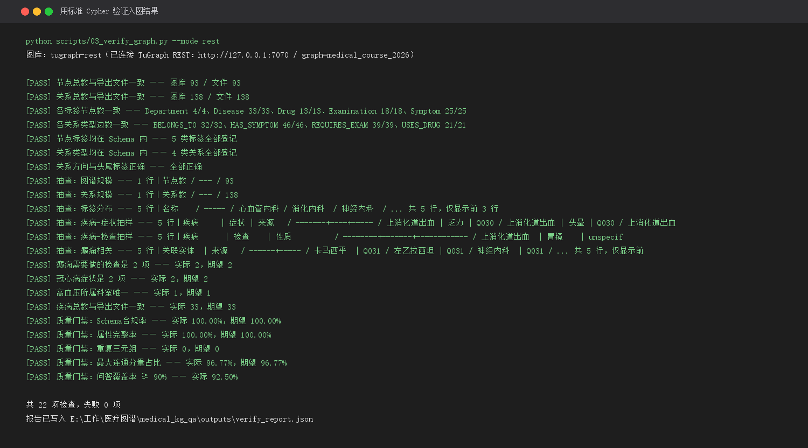
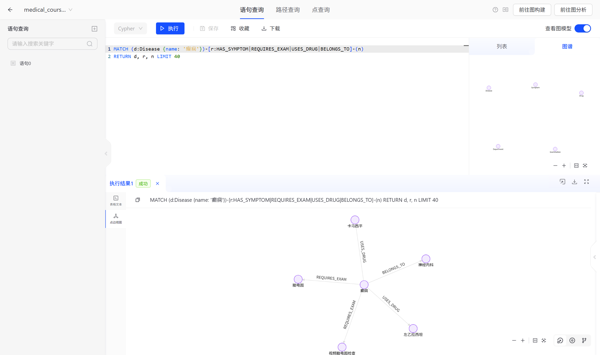

### 2.6 图谱质量评估

从 Schema 合规、属性完整、重复冲突、覆盖度、结构连通五个维度量化（`medkg/graph/quality.py`）：

| 指标 | 结果 | 说明 |
|---|---|---|
| 节点数 / 关系数 | 93 / 138 | 5 类点、4 类边 |
| 标签覆盖 | 5/5 | Disease、Symptom、Drug、Department、Examination |
| 关系覆盖 | 4/4 | HAS_SYMPTOM、USES_DRUG、BELONGS_TO、REQUIRES_EXAM |
| Schema 合规率 | 100.00% | 无越界标签、无方向错误 |
| 属性完整率 | 100.00% | 节点都有 name/description，边都有 qa_id/evidence |
| 重复三元组 | 0 | 融合阶段已去重 |
| 检查强度不一致 | 2 | 同一疾病的检查口径冲突，已进待审核清单 |
| 待人工审核 | 11 | 口径冲突、低频关系、可能的同义实体 |
| 孤立节点 | 3 | 糖尿病、面神经炎、体重下降（问答里没有可连的关系） |
| 弱连通分量 | 4 | 最大分量占 96.77%，图整体是连通的 |
| 平均度 | 2.97 | 每个节点平均连 3 条边，符合"疾病为中心"的星型结构 |
| 问答覆盖率 | 92.50% | 40 条问答中 37 条至少产出一条关系 |
| 科室覆盖 | 4/4 | 4 个科室都有疾病挂靠 |

结论：结构合规、无脏数据，主要问题是**稀疏**——33 个疾病里只有少数有完整的三类关系（症状/用药/检查），
孤立节点和 92.5% 的覆盖率说明"每条问答只贡献 1~2 条边"。这直接决定了后面问答系统必须能明确回答"查不到"，
而不能硬编。

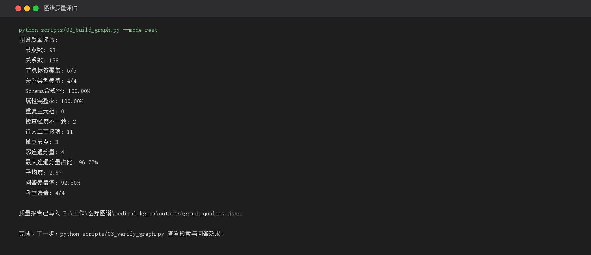

---

## 步骤 3　基础 Text2Cypher 与问答系统

### 3.1 大模型 API 配置

用 DashScope 的 OpenAI 兼容接口，Key 从环境变量读，不写进代码：

```ini
DASHSCOPE_API_KEY=sk-xxxxxxxx
LLM_BASE_URL=https://dashscope.aliyuncs.com/compatible-mode/v1
LLM_MODEL=qwen-plus
LLM_MODE=auto        # auto：有 Key 调 API，没有则用离线规则模型
```

`medkg/t2c/llm.py` 里 `OpenAICompatLLM` 用 `urllib` 发 `POST {base_url}/chat/completions`，
带 `Authorization: Bearer <key>`，`temperature=0` 保证同一问题输出稳定；没有 Key 或调用失败时自动降级到
`FakeLLM`（规则模板），保证课堂演示不中断。

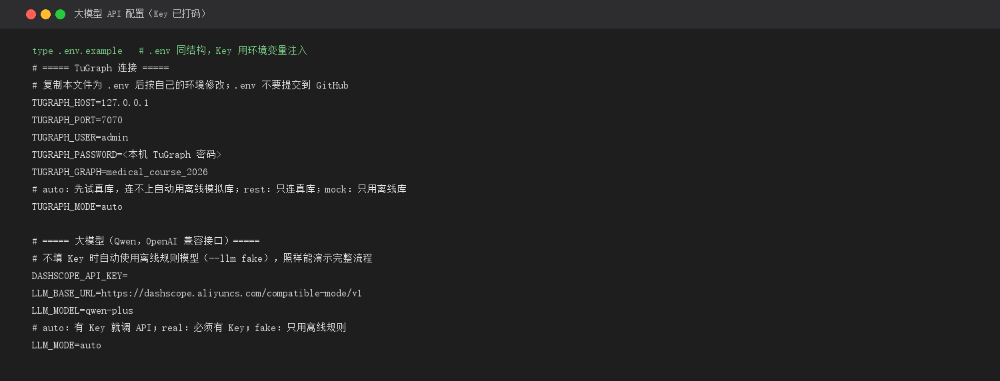

### 3.2 Prompt 构造

Prompt 分三部分（`medkg/t2c/prompt.py`）：

1. **角色与硬约束**：只输出 JSON；只读查询；只能用给定标签/关系；不确定就填 `unanswerable`；
2. **Schema 卡片**：由 `medkg/schema.py` 自动生成，杜绝手写与真实 Schema 不一致：

   ```
   节点：Disease(id,name,description)、Symptom(…)、Drug(…)、Department(…)、Examination(…)
   关系：(Disease)-[:HAS_SYMPTOM]->(Symptom)
         (Disease)-[:USES_DRUG]->(Drug)
         (Disease)-[:BELONGS_TO]->(Department)
         (Disease)-[:REQUIRES_EXAM {scope}]->(Examination)
   约束：只查 Disease 出发的关系；症状/药品/检查做条件时写在节点属性里
   ```

3. **实体提示 + few-shot**：把问句里识别到的实体（含归一后的标准名）作为 `entity_hints` 传入，
   再给 8 个示例（症状、用药、检查、科室、反向、多跳共同用药、计数、无法回答）。

输出约定：

```json
{"cypher": "MATCH (d:Disease {name: '癫痫'})-[:REQUIRES_EXAM]->(e:Examination) RETURN e.name AS 检查",
 "explanation": "查询癫痫需要做的检查", "unanswerable": false}
```

### 3.3 生成与安全校验

`medkg/t2c/generator.py` 的流程：

```
问题 → 意图识别（nlu/intent.py）→ 实体提示 → Prompt → LLM → 解析 JSON
     → 语法/安全校验（t2c/validator.py）→ 执行 → 失败则带错误信息重试 1 次 → 结果
```

校验器做的事：

- 拒绝写操作：`CREATE/MERGE/DELETE/SET/REMOVE/CALL/DROP/LOAD CSV`（防止模型"顺手"改库）；
- 检查标签与关系是否在 Schema 内（拼错 `Diesease` 直接报错，而不是返回空结果）；
- 检查是否缺少 `RETURN`、是否用了不支持的关系写法；
- 生成失败时把"上一轮 Cypher + 数据库报错"回灌给模型重试一次，仍失败则返回"无法回答"。

另外，即使模型生成了合法 Cypher，**执行前还会过一次意图-实体一致性检查**：问句里没有图谱实体、
或意图超出图谱范围（如"副作用""哪个更严重"）时直接拒答，不查库。

### 3.4 交互式问答系统

`cli.py` 提供命令行交互，支持 `help`（示例问题）、`schema`（查看结构）、`reset`（清空上下文）、`exit`：

```text
$ python cli.py
===== 医学知识图谱问答系统 =====
图谱：tugraph-rest　节点 93 个 / 关系 138 条
模型：qwen-plus（dashscope）
输入问题开始问答，exit 退出，help 查看示例。

问题> 癫痫要做哪些检查？
查询到 2 条记录：
1. 脑电图（建议做）  来源：Q031  证据：癫痫可以做哪些检查
2. 视频脑电图检查（建议做）  来源：Q031  证据：癫痫可以做哪些检查
审核状态：课堂参考，未经医学核验

问题> 那属于哪个科室？
  （结合上文补全为：癫痫 属于哪个科室？）
癫痫 属于 神经内科。
审核状态：课堂参考，未经医学核验

问题> exit
问答结束。
```

> 以上为连接真实 TuGraph + Qwen 时的输出；离线演示（`python cli.py --mock --demo`）内容一致，只是首行提示图库为 `mock-json`、模型为 `rule-template-v1`。

要点：

- **多轮追问**：`nlu/intent.py` 检测到"那/它/这个病"且缺少实体时，从上一轮的槽位补齐疾病，
  并提示"已根据上文补全为：癫痫"；
- **答案格式化**：`qa/formatter.py` 按关系类型给不同模板（列表 / "X 属于 Y" / "图谱中共有 N 种疾病"），
  每条都带来源 `qa_id` 与原文片段，末尾统一加"未经医学核验"；
- **不编造**：空结果返回"当前图谱中没有查到相关记录"，并说明可能是实体未入库或关系缺失；
  域外问题返回示例问法。

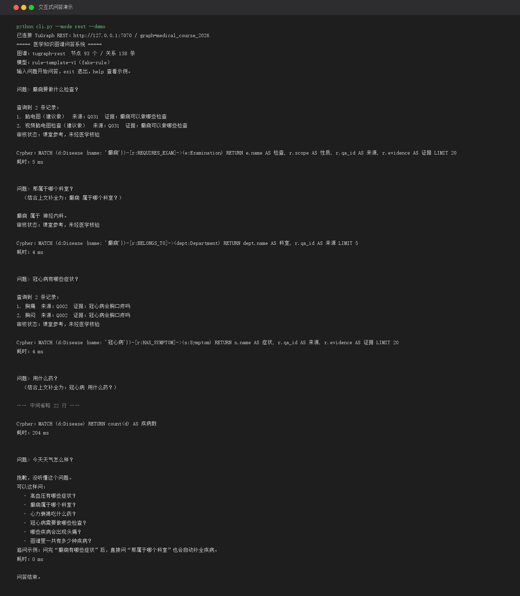
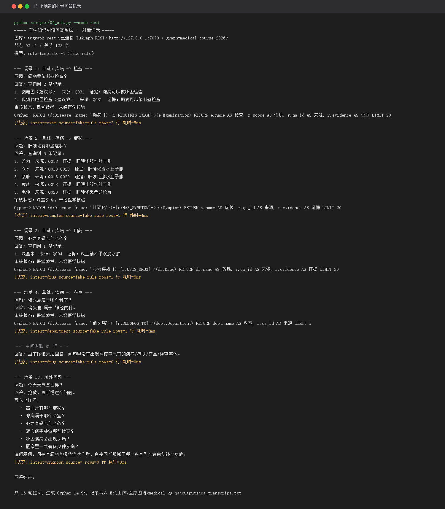

批量演示脚本 `scripts/04_ask.py` 覆盖 13 个场景、16 轮提问，输出 `outputs/qa_transcript.txt`（可直接贴进报告）：

| 场景 | 问题 | 结果 |
|---|---|---|
| 单跳-检查 | 癫痫要做哪些检查？ | 2 条（脑电图、视频脑电图检查） |
| 单跳-症状 | 肝硬化有哪些症状？ | 5 条 |
| 单跳-用药 | 心力衰竭吃什么药？ | 1 条（呋塞米） |
| 单跳-科室 | 偏头痛属于哪个科室？ | 神经内科 |
| 反向-症状 | 哪些疾病会出现头痛？ | 偏头痛 |
| 反向-药品 | 哪些疾病需要用奥美拉唑？ | 3 条 |
| 多跳-共同用药 | 脑梗死和冠心病有没有相同的用药？ | 阿司匹林、阿托伐他汀 |
| 计数 | 图谱里一共有多少种疾病？ | 33 种 |
| 多轮 | 癫痫要做哪些检查？→ 那属于哪个科室？ | 2 条 → 神经内科 |
| 多轮 | 胃溃疡有哪些症状？→ 吃什么药？→ 那要做什么检查？ | 3 条 → 奥美拉唑 → 胃镜 |
| 缺关系 | 糖尿病有哪些症状？ | 没有查到（已知 3 个孤立节点之一） |
| 实体未入库 | 青光眼用什么药？ | 无法回答（问句没有图谱实体） |
| 域外 | 今天天气怎么样？ | 拒答 + 示例问法 |

---

## 步骤 4　功能测试与对比

### 4.1 测试集设计

`scripts/build_testset.py` 生成 73 条测例（`data/testset/t2c_testset.csv`），字段：
`id,type,question,context,gold_cypher,note`。覆盖 16 类：

| 类型 | 条数 | 例子 | 考察点 |
|---|---|---|---|
| 单跳-症状 | 9 | 高血压有什么症状？ | 基础关系 |
| 单跳-用药 | 6 | 冠心病用什么药？ | 基础关系 |
| 单跳-检查 | 7 | 癫痫要做哪些检查？ | 基础关系 |
| 单跳-科室 | 5 | 偏头痛属于哪个科室？ | 基础关系 |
| 反向查询 | 6 | 哪些疾病会出现头痛？ | 换方向、跨类型实体做条件 |
| 多跳-共同用药 | 3 | 脑梗死和冠心病有没有相同的用药？ | 两条边共享节点 |
| 属性-简介 | 3 | 癫痫是什么病？ | 取 description |
| 计数 | 2 | 图谱里一共有多少种疾病？ | 聚合 |
| 别名口语 | 5 | 血压高有什么症状？/心衰要做哪些检查？ | 别名归一 |
| 空结果 | 7 | 糖尿病有哪些症状？ | 实体在、关系缺 |
| 无法回答 | 4 | 青光眼用什么药？ | 实体未入库 |
| 域外问题 | 3 | 今天天气怎么样？ | 拒答 |
| 多轮追问 | 8 | 癫痫要做哪些检查？→ 那属于哪个科室？ | 上下文补全 |
| 难例-两跳 | 2 | 哪些科室能看头痛？ | 症状→疾病→科室 |
| 难例-否定 | 1 | 除了阿司匹林，冠心病还能用什么药？ | 否定约束 |
| 边界问题 | 2 | 吃阿司匹林会有什么副作用？ | 图谱无此建模，应拒答 |

金标 Cypher 由脚本按模板生成（`sym()`、`drug()`、`exam()`、`dept()`、`reverse_*()`、`shared(a,b)`、
`dept_by_symptom()`、`drug_excluding()`、`COUNT`），保证与 Schema 一致、可执行。

### 4.2 对比方案

| 编号 | 系统 | 说明 |
|---|---|---|
| B0 | 关键词基线 | 只按关键词匹配单跳四类（症状/用药/检查/科室），其他类型直接答"不支持" |
| B1 | 消融：去掉别名归一 | 与 B2 相同，但实体不归一（"血压高"不映射到"高血压"） |
| B2 | 本系统 | Schema 感知 Prompt + 实体提示 + 安全校验 + 多轮改写（规则管线实现，离线可复现） |
| — | 大模型版 | `--llm real` 时把同一 Prompt 发给 Qwen，用于与规则管线对照（需 API Key） |

评测指标：

- **可执行率**：生成的 Cypher 能跑通（无语法/Schema 错误）的比例；
- **EM**：生成的 Cypher 与金标逐字一致（归一化空白后）的比例；
- **EX**：执行结果（第一列取值集合）与金标一致的比例，**主指标**；
- **端到端正确率**：EX 通过，且"应当拒答"的题目确实拒答。

### 4.3 总体结果

```bash
python scripts/05_evaluate.py --mock        # 离线，无需 TuGraph
python scripts/05_evaluate.py --mode rest --llm real   # 真库 + Qwen
```

| 系统 | 可执行率 | EM | EX | 端到端正确率 |
|---|---|---|---|---|
| B0 关键词基线 | 75.0% | 0.0% | 73.4% | 75.3% |
| B1 消融：去掉别名归一 | 98.4% | 12.3% | 82.8% | 83.6% |
| **B2 本系统（规则管线）** | **98.4%** | 12.3% | **95.3%** | **94.5%** |

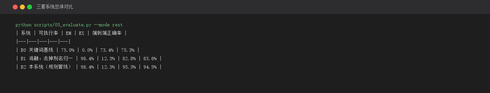

分类型结果（B2）：

| 类型 | 条数 | 可执行率 | EX | 端到端 |
|---|---|---|---|---|
| 单跳-症状 / 用药 / 检查 / 科室 | 9 / 6 / 7 / 5 | 100% | 100% | 100% |
| 反向查询 | 6 | 100% | 100% | 100% |
| 多跳-共同用药 | 3 | 100% | 100% | 100% |
| 属性-简介 | 3 | 100% | 100% | 100% |
| 计数 | 2 | 100% | 100% | 100% |
| 别名口语 | 5 | 100% | 100% | 100% |
| 空结果 | 7 | 100% | 100% | 100% |
| 无法回答 / 域外问题 | 4 / 3 | — | — | 100% |
| 多轮追问 | 8 | 100% | 100% | 100% |
| 难例-两跳 | 2 | 50% | 0% | 0% |
| 难例-否定 | 1 | 100% | 0% | 0% |
| 边界问题 | 2 | — | — | 50% |

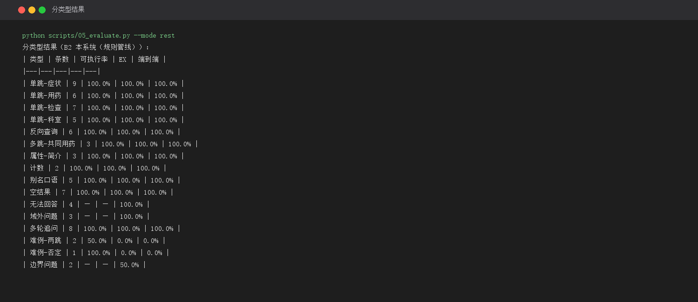

### 4.4 分析

**（1）Schema 感知 + 实体提示的作用（B0 → B2）**

B0 只能答单跳四类，遇到反向（"哪些疾病会出现头痛"）、多跳（共同用药）、属性（"是什么病"）、
计数（"一共多少种疾病"）一律拒答，可执行率只有 75%、端到端 75.3%。B2 把这四类都补上后，
端到端提升 **+19.2 个百分点**。这说明**意图覆盖面**比"把一条 Cypher 写得多漂亮"更影响可用性。

**（2）别名归一的作用（B1 → B2）**

消融掉归一后，EX 从 95.3% 掉到 82.8%（-12.5），端到端从 94.5% 掉到 83.6%（-10.9）。失败集中在：

- T07 `高血压病有哪些症状？`、T26 `耳石症属于哪个科室？`：别名没归一，按原词查节点，返回空；
- T42–T46（别名口语 5 条）：`血压高`/`心衰`/`房颤`/`胃食管反流` 全部查不到；
- 说明口语化医疗问法里"标准名 ≠ 用户说法"是主要风险，词典 + 归一必须做在生成之前。

**（3）EM 只有 12.3% 的原因**

金标 Cypher 用短别名、只 RETURN 一列；生成器习惯带 `r.qa_id`、`r.evidence` 以便溯源，`LIMIT` 也不同。
于是"语义等价但写法不同"会被 EM 判错。EX 只看结果集合，更能反映"答得对不对"。
报告保留 EM 是为了说明**逐字比对不适合作为 Text2Cypher 的主指标**。

**（4）剩余 4 条失败（B2）**

| 编号 | 问题 | 系统输出 | 错因 | 改进 |
|---|---|---|---|---|
| T69 | 胸口疼要看什么科？ | 拒答（问句无图谱实体） | "胸口疼"是"胸痛"的口语说法，词典未收录 | 补同义词 + 口语映射表 |
| T70 | 哪些科室能看头痛？ | 查 `Disease{name:'头痛'}`，0 行 | 需要"症状→疾病→科室"两跳，规则管线只做单跳 | 增加两跳意图模板（`MATCH (dept)<-[:BELONGS_TO]-(d)-[:HAS_SYMPTOM]->(s{name})`） |
| T71 | 除了阿司匹林，冠心病还能用什么药？ | 忽略否定，返回含阿司匹林的完整列表 | 未解析"除了…"否定约束 | 识别排除实体，生成 `WHERE dr.name <> '阿司匹林'` |
| T73 | 高血压和糖尿病哪个更严重？ | 当作"是什么病"返回简介 | 比较类问题超出图谱建模范围，应拒答 | 增加"比较/严重程度"意图，直接拒答 |

**（5）边界与拒答**

"空结果 / 无法回答 / 域外问题 / 边界问题"共 16 条，B2 端到端通过 15 条（93.8%）。
唯一失败是 T73。这组测例的价值在于证明系统**不硬编答案**：查不到就说查不到，
比"编一个看起来合理的答案"更符合医疗场景的要求。

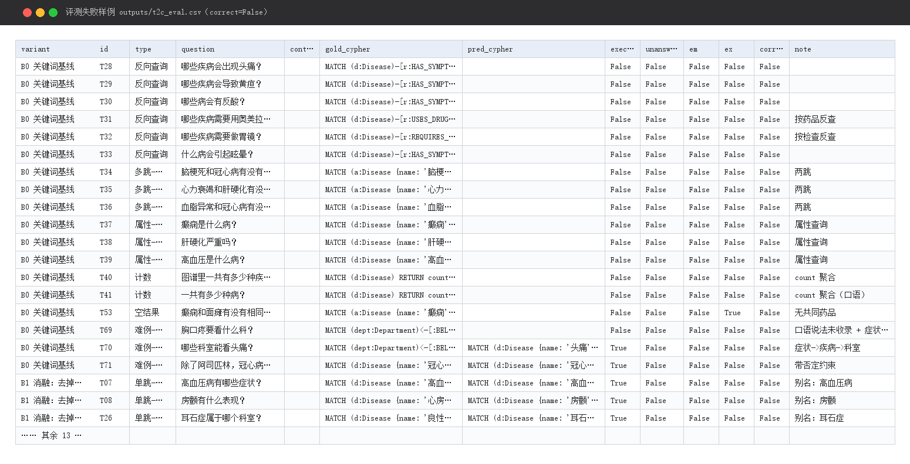
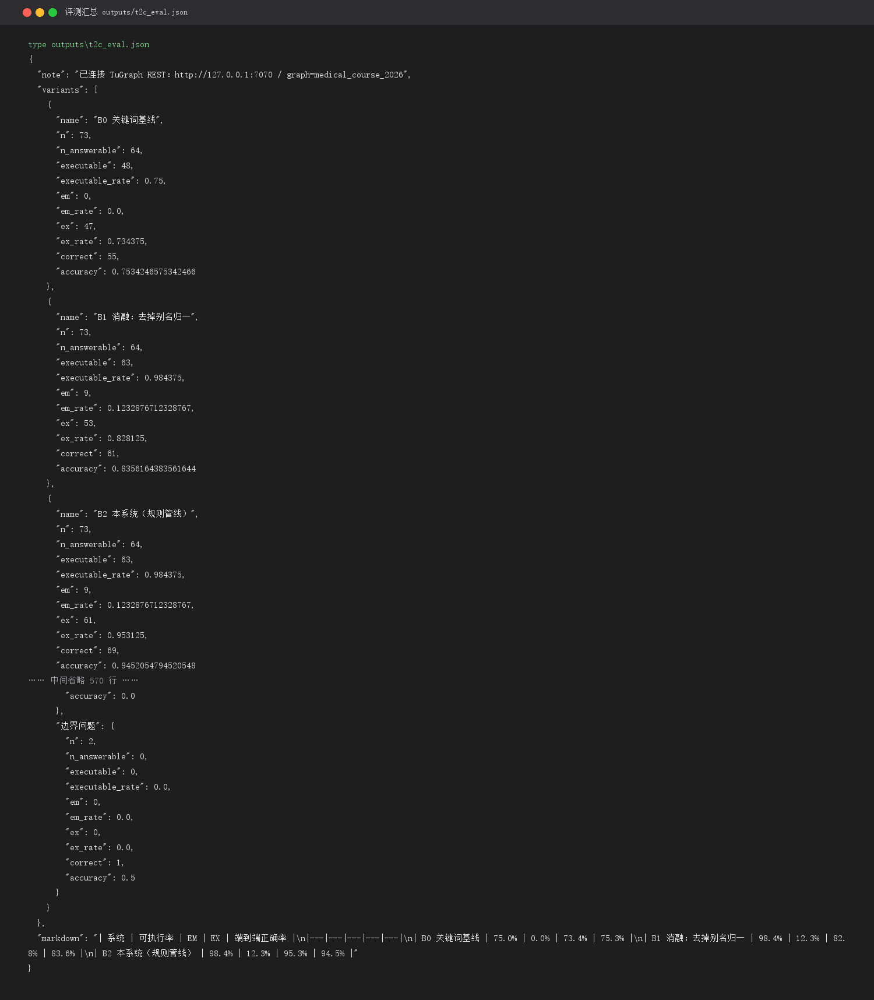

---

## 四、问题与解决

| 问题 | 现象 | 解决 |
|---|---|---|
| TuGraph 连不上 | `Connection refused`，脚本抛一堆堆栈 | 统一在 `storage/tugraph_rest.py` 捕获，改成可操作提示（检查容器/端口/建图），并支持 `--mock` 离线演示 |
| 图不存在 | 登录成功但查询报图不可用 | `ensure_graph()` 自动尝试 `CALL db.createGraph`，失败才提示去控制台建图 |
| DDL 类型报错 | 4.x 要求类型加引号，3.x 不加 | `ddl_statements(legacy_types=…)`，脚本提供 `--legacy` |
| 中文乱码 | PowerShell 输出乱码 | `$env:PYTHONIOENCODING="utf-8"`，日志统一 `Out-File -Encoding utf8` |
| 离线库不支持某些 Cypher | 报"离线模拟库不支持…" | 明确边界：写操作、UNION、OPTIONAL MATCH 一律拒绝，连真库才执行 |
| 金标与生成器写法不同 | EM 很低 | 引入 EX（结果集比对）作主指标，报告中解释 EM 的局限 |
| 词典末行缺换行 | 追加实体后两行黏在一起，解析出错 | 补换行并加单元自检（`01_preprocess.py` 会校验词典条数） |

## 五、总结与改进

**完成情况**：环境部署、图谱构建、Text2Cypher、功能测试与对比四个环节全部落地，离线与真库两条路径都能跑通；图谱 93 节点 / 138 边，
Schema 合规率与属性完整率均 100%，问答覆盖率 92.5%；Text2Cypher 端到端正确率 94.5%，
相比关键词基线提升 19.2 个百分点，相比去归一消融提升 10.9 个百分点。

**主要收获**：

1. **Schema 是 Text2Cypher 的地基**：Prompt 里的 Schema 卡片、DDL、生成后校验共用一个定义，
   模型才不会写出图谱里不存在的标签；
2. **归一化比 Prompt 调优更划算**：口语别名不解决，模型再强也查不到节点；
3. **拒答是一等功能**：图谱稀疏时，"不知道"比"编一个"更有价值；
4. **评测要选对指标**：EM 会低估语义等价的生成结果，EX 更贴近实际可用性。

**不足与改进**：

1. 数据规模小（40 条问答），关系稀疏，孤立节点 3 个 → 扩充问答、引入公开医疗图谱补充；
2. 规则管线不支持两跳、否定、比较类问题 → 补充对应意图模板，或把这类问题交给大模型生成、规则校验兜底；
3. 实体识别仍是词典匹配，未覆盖未登录词 → 引入 BERT/LLM 做 NER，词典只做归一；
4. 单轮评测为主，多轮只覆盖 8 条 → 增加指代、省略、纠错等对话现象；
5. 未做性能压测 → 补并发与延迟测试（当前离线单查询 0–2 ms，真库待测）。

---

## 附录 A　运行命令速查

| 目的 | 命令 |
|---|---|
| 环境自检 | `python scripts/00_check_env.py` |
| 连接测试 | `python scripts/test_connection.py` |
| 建 Schema | `python scripts/init_schema.py`（`--dry-run` 只打印 DDL） |
| 清洗 + NER/RE | `python scripts/01_preprocess.py` |
| 构图入图 | `python scripts/02_build_graph.py --mode rest` / `--mock` |
| 入图验证 | `python scripts/03_verify_graph.py --mock` |
| 问答演示 | `python cli.py --mode rest` / `python cli.py --mock --demo` |
| 批量问答 | `python scripts/04_ask.py --mock --fake` |
| 生成测例 | `python scripts/build_testset.py` |
| 评测对比 | `python scripts/05_evaluate.py --mock` |
| 一键全流程 | `pwsh -File scripts\run_all.ps1` / `bash scripts/run_all.sh` |
| 重新生成报告 | `python scripts/build_report_docx.py`（由 md 生成 docx） |

## 附录 B　截图清单

19 张图均已嵌入正文对应位置，原文件在 `docs/images/`：

| 编号 | 文件 | 内容 |
|---|---|---|
| 1 | 01-tugraph-login.png | TuGraph 控制台登录页 |
| 2 | 02-connection-test.png | 客户端连接三步请求/响应 |
| 3 | 03-env-check.png | 环境自检表 |
| 4 | 04-init-schema.png | 建 Schema DDL 输出 |
| 5 | 05-clean-data.png | 清洗后 CSV |
| 6 | 06-ner-result.png | 三种 NER 策略对比 |
| 7 | 07-review-items.png | 待审核/冲突项 |
| 8 | 08-import-graph.png | 入图输出 |
| 9 | 09-graph-list.png | 图项目列表（93 点 / 138 边） |
| 10 | 10-verify-graph.png | 22 项验证全 PASS |
| 11 | 11-cypher-console.png | 图查询面板：Cypher + 图谱视图 |
| 12 | 12-graph-quality.png | 质量指标表 |
| 13 | 13-llm-config.png | 模型配置 |
| 14 | 14-cli-demo.png | CLI 多轮对话 |
| 15 | 15-cli-transcript.png | 13 场景对话记录 |
| 16 | 16-eval-overall.png | 三系统汇总 |
| 17 | 17-eval-bytype.png | 分类型结果 |
| 18 | 18-eval-detail.png | 失败样例明细 |
| 19 | 19-eval-json.png | JSON 汇总 |

## 附录 C　文件清单（提交内容）

| 路径 | 说明 |
|---|---|
| `medkg/` | 核心库（etl / extract / graph / storage / nlu / t2c / qa / eval） |
| `scripts/00~05*.py`、`build_testset.py` | 全流程脚本 |
| `scripts/run_all.ps1`、`run_all.sh` | 一键跑通离线全流程 |
| `scripts/build_report_docx.py` | 由 `实验报告.md` 生成本地 docx（含截图排版，产物不入库） |
| `scripts/make_screenshots.py`、`capture_ui.py` | 步骤截图生成（终端渲染 / 控制台实拍） |
| `scripts/embed_screenshots.py` | 把 `docs/images/` 的图插回报告 Markdown |
| `cli.py` | 交互式问答入口 |
| `requirements.txt`、`.env.example` | 依赖与配置模板 |
| `data/raw/`、`data/clean/`、`data/dict/`、`data/gold/` | 原始数据、清洗结果、词典、人工标注 |
| `data/graph/` | 节点/边 CSV、import.yaml、待审核项、统计 |
| `data/testset/t2c_testset.csv` | 73 条 Text2Cypher 测例 |
| `outputs/` | 质量报告、验证报告、评测明细、对话记录 |
| `docs/实验报告.md` | 提交用报告（GitHub 在线预览版，含 19 张截图） |
| `docs/images/` | 截图存放目录（含 19 张截图的清单说明） |
| `docs/日志示例/` | 各步骤在真实 TuGraph（`--mode rest`）下的控制台日志 |

---

> 本实验数据来自课堂问答整理，仅用于课程练习，**未经医学核验**，不能作为诊疗依据。
